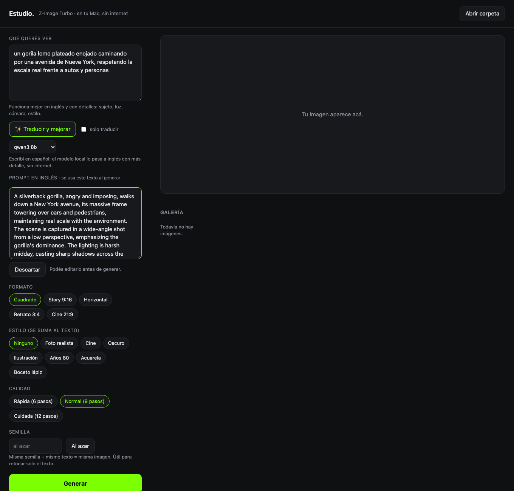

# Estudio · imágenes con IA 100 % locales en tu Mac, con traductor de prompts

> **English summary:** a small local web app (Python standard library only, no npm/pip) that generates images on Apple Silicon with [mflux](https://github.com/filipstrand/mflux) + Z-Image Turbo (8-bit), and uses a local LLM through [Ollama](https://ollama.com) to translate and enrich ideas written in Spanish into good English prompts. After the one-time model downloads, everything runs offline. The UI and docs are in Spanish.



## La idea

Z-Image Turbo rinde mejor con prompts largos y detallados en inglés, y la propia ficha del modelo recomienda pasarlos por un LLM para mejorarlos. Casi nadie escribe así: escribimos una idea corta en nuestro idioma.

Este proyecto cierra ese hueco sin salir de tu máquina. Escribís en español *"una pareja de nutrias tomadas de la mano, vistas desde el visor de una cámara"*, un modelo chico local (Qwen3 8B, vía Ollama) lo convierte en un prompt en inglés de unas 100 palabras, vos lo revisás o lo editás, y recién ahí se genera la imagen. Sin cuentas, sin APIs, sin que tus ideas ni tus imágenes salgan de tu Mac.

## Qué hace

- **Genera imágenes** con Z-Image Turbo en 9 pasos, con formatos (cuadrado, story 9:16, horizontal, retrato, cine), estilos, tres niveles de calidad y semilla reproducible.
- **✨ Traducir y mejorar:** pasa tu idea a un prompt en inglés con luz, cámara, composición y atmósfera. Con la casilla *solo traducir* hace solo la traducción fiel.
- **El prompt en inglés queda en un cuadro editable.** Si después cambiás el texto en español, la app te avisa y no genera con la versión vieja.
- **Elegís el modelo** entre los que tengas en Ollama.
- **Galería local:** reusar texto y semilla, mostrar en Finder y borrar (va a la Papelera de macOS, es recuperable).
- Un servidor de un solo archivo (`server.py`) y una página (`index.html`). Escucha solo en `127.0.0.1`.

## Lo que medí en mi equipo (Mac con M3 Pro, 36 GB)

| Imagen de 1024×1024 | Modelo sin cuantizar | Copia de 8 bits (la que usa esta app) |
|---|---|---|
| Tiempo | ~13 min (se va a swap) | ~2 min |
| Memoria pico | ~25,8 GB | ~7,5 GB |

Traducir y mejorar con Qwen3 8B tardó entre 3 y 13 s en mis pruebas. Son cifras de una sola máquina: si hay otras cosas pesadas corriendo (por ejemplo una descarga grande), puede tardar bastante más.

## Requisitos

- Mac con **Apple Silicon** (mflux usa MLX). Lo probé en un M3 Pro con 36 GB; con menos memoria no lo probé.
- Python 3 (solo usa la biblioteca estándar) y [uv](https://docs.astral.sh/uv/) para instalar mflux.
- Espacio: unos 10 GB para la copia de 8 bits y unos 5 GB para Qwen3 8B. La primera descarga del modelo original ocupa bastante más (unos 33 GB en la caché de Hugging Face en mi caso).
- [Ollama](https://ollama.com), solo para el botón del traductor. Sin Ollama podés generar igual escribiendo el prompt directamente en inglés.

## Instalación

1. **Instalá mflux**
   ```bash
   brew install uv        # si todavía no lo tenés
   uv tool install mflux
   ```
2. **Guardá una copia cuantizada de Z-Image Turbo** (la primera vez descarga el modelo original, tarda y pesa):
   ```bash
   mflux-save --model z-image-turbo --path ~/mflux-models/z-image-turbo-8bit --quantize 8
   ```
   Sin cuantizar, el modelo ocupa ~25,8 GB de memoria y en una Mac de 36 GB cae en swap. Con esta copia pasa a ~7,5 GB.
3. **Bajá el modelo del traductor**
   ```bash
   ollama pull qwen3:8b
   ```
4. **Abrí el Estudio**
   ```bash
   python3 server.py
   ```
   o hacé doble clic en `Estudio.command`. Se abre `http://localhost:8777`.

## Configuración

Todo es opcional; se define con variables de entorno.

| Variable | Qué hace | Por defecto |
|---|---|---|
| `ESTUDIO_MODELO` | Carpeta de la copia cuantizada | `~/mflux-models/z-image-turbo-8bit` |
| `ESTUDIO_GALERIA` | Dónde se guardan las imágenes (PNG + JSON con el prompt y la semilla) | `./galeria` |
| `ESTUDIO_PUERTO` | Puerto del servidor | `8777` |
| `ESTUDIO_LLM` | Modelo de Ollama preferido para traducir | `qwen3:8b`; si no está, prueba `qwen3:4b`, `mistral`, `llama3.2` y si no el primero que haya |
| `ESTUDIO_OLLAMA` | Dirección de Ollama | `http://127.0.0.1:11434` |
| `ESTUDIO_MFLUX` | Ruta al ejecutable `mflux-generate-z-image-turbo` | el que encuentre en el `PATH` |
| `ESTUDIO_NO_ABRIR` | Si está definida, no abre el navegador al arrancar | — |

Ejemplo: `ESTUDIO_PUERTO=9000 ESTUDIO_LLM=qwen3:4b python3 server.py`

## Cómo funciona

- `server.py` es un `ThreadingHTTPServer` que lanza `mflux-generate-z-image-turbo` como subproceso y lee su salida para mostrar el progreso paso a paso. Genera una imagen a la vez.
- Para traducir llama a la API de Ollama (`/api/chat`) con un prompt de sistema que conserva el sujeto y los detalles del usuario, enriquece con luz, cámara y atmósfera, respeta el texto que tenga que aparecer dentro de la imagen y **no agrega carteles ni palabras que no pediste**.
- Usa `keep_alive: 0`: el modelo de lenguaje se descarga de memoria apenas responde, así no compite con el de imágenes.
- Si Ollama está apagado, la app intenta abrirlo sola.

## Límites que conviene conocer

- **Elegí bien el modelo del traductor.** En mis pruebas Qwen3 8B tradujo bien, pero `mistral` 7B tradujo "nutrias" como *beavers* (castores) y `llama3.2` 3B inventó "un hombre y una mujer". Revisá siempre el cuadro en inglés antes de generar.
- **Texto dentro de la imagen:** Z-Image Turbo a veces escribe mal las palabras. Si pasa, probá otra semilla o agregá el texto después en un editor.
- **Solo macOS con Apple Silicon:** usa `open`, la Papelera de macOS y mflux (MLX).
- **Sin autenticación:** está pensado para correr en tu propia máquina, solo en `127.0.0.1`. No lo expongas a la red.
- **Lo que generes es responsabilidad tuya:** revisá derechos de autor, marcas y las licencias de cada modelo.

## Créditos

- [mflux](https://github.com/filipstrand/mflux), de Filip Strand: Z-Image y otros modelos sobre MLX.
- [Z-Image-Turbo](https://huggingface.co/Tongyi-MAI/Z-Image-Turbo), de Tongyi-MAI (Alibaba), licencia Apache-2.0. Paper: *Z-Image: An Efficient Image Generation Foundation Model with Single-Stream Diffusion Transformer* (Z-Image Team, arXiv:2511.22699).
- [Ollama](https://ollama.com) y [Qwen3](https://huggingface.co/Qwen).
- Creado con ayuda de Claude (Anthropic).

## Licencia

[MIT](LICENSE) para el código de este repositorio. Los modelos tienen sus propias licencias.
